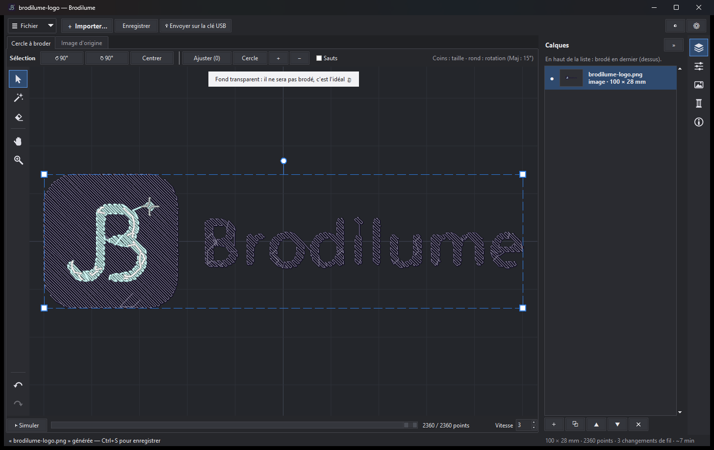
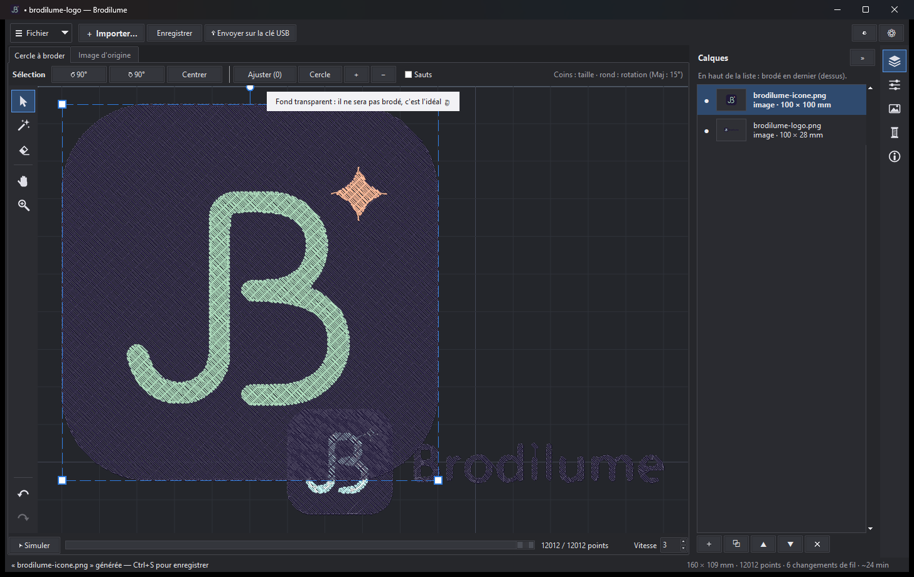
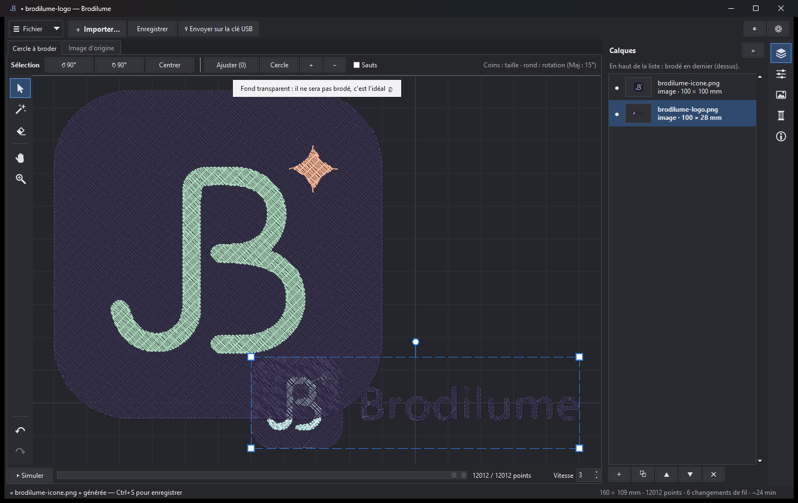
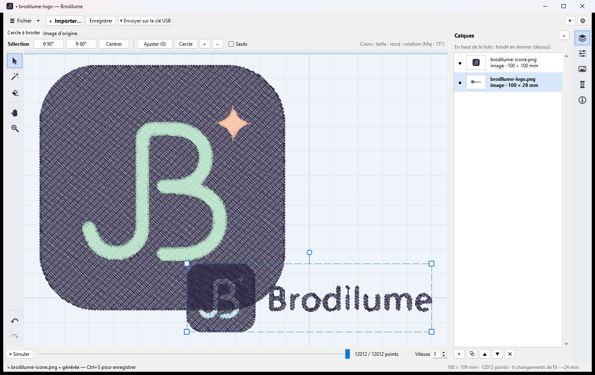

# Brodilume

**Transformez une image en fichier de broderie.** Brodilume convertit un logo, un dessin ou une
photo simplifiée en motif de broderie **.vp4** (Husqvarna Viking / Pfaff, logiciel mySewnet) et
l'exporte aussi vers les autres formats courants (.vp3, .pes, .jef, .exp, .dst…). Vous pouvez
composer plusieurs images dans le même cercle, les déplacer, les tourner, retirer des points, fusionner
des couleurs, puis envoyer le résultat directement sur une clé USB.



## Points forts

- **Image → broderie en quelques clics** : réduction des couleurs, remplissage tatami, sous-couche,
  points droits pour les petits détails (étoiles, reflets, liserés).
- **Plusieurs éléments dans un même cercle** : redimensionner, déplacer, tourner, réordonner, masquer.
- **Édition fine** : gomme autour des points, sélection et suppression d'une partie de couleur,
  fusion de deux couleurs (Ctrl+clic), nombre de couleurs à régler (et suggestion automatique).
- **Fils réels** : chaque couleur devient le fil le plus proche d'une gamme (lue dans votre installation mySewnet).
- **Export** : .vp4, .vp3, .pes, .jef, .exp, .xxx, .dst, .u01, aperçu PNG, fiche de broderie imprimable.
- **Clé USB** : détection automatique, choix du format avec des exemples de machines.
- **Interface** Photoshop-like : panneaux de calques et de propriétés, thème clair ou sombre (suit Windows),
  raccourcis clavier configurables, annuler / rétablir (60 étapes).
- **Projets `.brodi`** : enregistrez votre travail (images d'origine, réglages, positions) et rouvrez-le plus tard.

## Captures d'écran

| | |
|---|---|
|  |  |
| Plusieurs éléments dans le cercle à broder | Sélection d'un élément, panneau des calques |
|  | |
| Thème clair (par défaut : celui de Windows) | |

## Installation (utilisateurs)

1. Ouvrez la page **[Releases](../../releases)** du projet et téléchargez **`Brodilume.exe`** (un seul fichier, aucune installation).
2. Double-cliquez dessus. Windows peut afficher « Windows a protégé votre PC » (l'application n'est pas
   signée par un éditeur reconnu) : cliquez sur **Informations complémentaires**, puis **Exécuter quand même**.
3. Si un antivirus (McAfee, Defender…) bloque ou met en quarantaine le fichier, ajoutez une exception
   pour `Brodilume.exe` dans ses paramètres. Vérifiez que le fichier vient bien de cette page.

Brodilume ne nécessite ni Python ni connexion Internet. Il crée ses réglages dans `%APPDATA%\Brodilume\`.

**Fils nommés** : si le logiciel **mySewnet** (CREATIVATE Embroidery) est installé sur le PC, Brodilume lit
ses nuanciers (lecture seule) pour proposer de vrais fils. Sans mySewnet, les couleurs sont gardées telles
quelles, sans nom de fil.

## Premiers pas

1. **Importer** une image (Ctrl+I, ou glisser-déposer depuis l'Explorateur, ou Ctrl+V pour coller une image copiée).
   PNG, JPEG, GIF, WebP. Les images aux couleurs franches (logos, dessins) donnent les meilleurs résultats.
2. Brodilume génère la broderie automatiquement. Ajustez la **largeur**, le **nombre de couleurs** et les
   **petits détails** dans le panneau *Image*.
3. Ajoutez d'autres images si besoin, placez-les dans le cercle.
4. **Enregistrer** en `.brodi` (votre projet), puis **Exporter** le .vp4 ou **Envoyer sur la clé USB**.

Le détail complet de chaque réglage et de chaque raccourci est ci-dessous.

## Compiler soi-même l'exécutable

Pour fabriquer `Brodilume.exe` depuis le code source (Windows 10/11, Python 3.10) :

```bash
build_exe.bat
```

Le script crée un environnement propre (`.build-venv`) avec les seules dépendances du projet, puis
produit `dist\Brodilume.exe`. Compilez depuis un environnement propre : un Python déjà chargé de
nombreux paquets (torch, etc.) ferait grossir l'exécutable de plusieurs Go.

## Lancer depuis le code source

```bash
python -m pip install -r requirements.txt
python app.py
```

Sur Windows, `Brodilume.bat` lance l'application sans fenêtre de console, et accepte un fichier en
argument (glisser une image ou un .vp4 sur le .bat l'ouvre directement).

## Composer plusieurs éléments

- **Ajouter des images / broderies…** (Ctrl+O, sélection multiple) : chaque fichier devient un élément
  du projet (liste « Éléments » à droite, dans l'ordre de broderie ; ▲ ▼ pour changer l'ordre,
  Dupliquer = Ctrl+D, Supprimer = Suppr, Nouveau projet = Ctrl+N).
- **Disposition** (façon Photoshop) : barre du haut (Ajouter, Nouveau, Enregistrer, Exporter, ◐, ⚙),
  outils à gauche, et à droite une colonne d'icônes qui ouvre **un panneau à la fois** : Calques,
  Propriétés (position, taille, rotation), Image (réglages de conversion), Couleurs (fils), Infos.
  Recliquer l'icône active (ou ») replie le panneau pour agrandir le cercle. Le résumé du motif
  (taille, points, changements de fil, durée) reste visible dans la barre d'état.
- **Calques** : vignette, nom et taille de chaque élément ; en haut = brodé en dernier (dessus).
  ● / ○ = afficher / masquer (un élément masqué n'est pas enregistré). Double-clic = Propriétés,
  clic droit = menu (renommer, dupliquer, ordre, supprimer…).
- **Barre d'outils** verticale à gauche du cercle (comme Photoshop) : Sélection (V), Couleurs (C),
  Gomme (E), Main (H, faire glisser la vue), Zoom (Z, clic = avant, Maj+clic = arrière). Survol = nom et
  raccourci ; la barre du haut montre les options de l'outil actif. En bas de la barre : annuler /
  rétablir (flèches courbes, grisées quand il n'y a rien à annuler ou rétablir).
- **Navigation** : Ctrl+molette (ou Alt+molette) = zoom sous la souris ; molette = défiler en hauteur,
  Maj+molette = en largeur ; bouton du milieu (ou droit) + glisser = déplacer la vue, avec Maj = sur un
  seul axe ; Espace maintenu + glisser = main temporaire (Espace seul = simulation) ; flèches sans
  élément sélectionné et Ctrl+flèches = défiler (Maj : plus vite) ; Ctrl+0 = taille réelle, Ctrl+1 = cercle entier.
- **Espace de broderie** : Paramètres > Général, cercles « Universal » de 100 × 100 à 360 × 350 mm ou
  taille personnalisée. Jusqu'à 260 × 200 mm le fichier indique UniLarge3 (vérifié) ; au-delà, le nom
  Universal_LxH du logiciel (à vérifier dans mySewnet).
- **Thème** clair ou sombre : par défaut celui de Windows (suivi en direct). ◐ ou Ctrl+Maj+T bascule ;
  Paramètres > Général pour revenir à « Comme Windows ».
- Outil **Sélection** (V) : glisser un élément pour le déplacer (flèches : 1 mm, Maj+flèches : 10 mm),
  coins = taille, rond au-dessus = rotation (Maj : par pas de 15°). Champs X / Y / Largeur / Rotation.
  Une image redimensionnée est régénérée à sa nouvelle taille (densité des points conservée) ;
  une broderie importée est mise à l'échelle.
- Outil **Gomme** (E) : entourer à la souris les points à retirer, sur l'élément sélectionné (ou sur
  tous si aucun n'est sélectionné). « seulement le fil sélectionné » : ne retire qu'une couleur.
  Le fil est coupé et saute par-dessus la partie gommée. La gomme est réappliquée si l'image est
  régénérée ; « Annuler la gomme » la retire d'une image, Ctrl+Z annule n'importe quelle étape.
- Les réglages de gauche s'appliquent à l'image sélectionnée. À l'enregistrement, deux fils
  identiques qui se suivent sont réunis (un changement de fil de moins).
- Outil **Couleurs** (C) : clic sur la broderie = sélectionne une *partie* de couleur (une zone ou un
  trait, entre deux sauts) ; **Ctrl+clic** (ou Maj+clic) = en ajouter / retirer ; **double-clic** =
  toutes les parties de ce fil (Ctrl+double-clic : les ajouter). Le reste est estompé.
  **Suppr** supprime la sélection (sinon le fil sélectionné, sinon l'élément).
  **Fusionner les couleurs** (Ctrl+G) : les parties sélectionnées prennent une seule couleur, choisie
  dans une fenêtre si elles en ont plusieurs. Image : la broderie est recalculée, la zone fusionnée est
  remplie d'un seul tenant, et la fusion est refaite à chaque régénération. Broderie importée : pas
  d'image d'origine, les points sont gardés et passent au fil choisi.
  Les suppressions sont refaites quand l'image est régénérée.
- Panneau **Couleurs** : sans élément sélectionné, il liste toutes les couleurs du projet, par élément.
  ✕ supprime un fil. **Nombre de couleurs − / +** : une image est régénérée avec une couleur de moins
  ou de plus ; pour une broderie importée, « − » fusionne les deux fils les plus proches.
  **Suggérer** : calcule le nombre de couleurs utile pour l'image (au-delà, une couleur de plus change peu).
- Clic droit ou bouton du milieu : déplacer la vue.

## Menu Fichier, projets, exports, clé USB

- **☰ Fichier** : Nouveau projet (Ctrl+N), Ouvrir un projet (Ctrl+O), Projets récents (10 derniers),
  Importer une image (Ctrl+I : PNG, JPEG, GIF, WebP) ou une broderie (.vp4, .vp3), Coller une image,
  Enregistrer (Ctrl+S) / Enregistrer sous (Ctrl+Maj+S), Exporter, Envoyer sur la clé USB (Ctrl+U),
  Paramètres, Fermer le projet (Ctrl+W), Quitter (Ctrl+Q). Avant de fermer un projet modifié,
  Brodilume propose de l'enregistrer (le titre de la fenêtre commence par « • » tant qu'il y a des
  modifications non enregistrées).
- **Projet `.brodi`** : notre format, réouvrable et modifiable (images d'origine, réglages, positions,
  gomme, fusions et suppressions de couleurs). C'est une archive zip lisible (`projet.json` + images + points).
- **Exporter** : .vp4 (notre écrivain), .vp3, .pes, .jef, .exp, .xxx, .dst, .u01 (via la bibliothèque
  libre `pyembroidery` : `python -m pip install pyembroidery`), aperçu PNG, et **fiche de broderie**
  (aperçu + dimensions + durée + liste des fils dans l'ordre, pratique à imprimer).
- **Envoyer sur la clé USB** : actif dès qu'une clé est branchée. Une fenêtre propose la clé, le nom et
  le ou les formats, avec pour chacun des exemples de machines (liste non exhaustive) ; le choix est retenu.
- À l'import, un petit conseil s'affiche selon le fichier (JPEG, fond transparent, image trop petite…).

## Raccourcis clavier, presse-papiers, glisser-déposer

- Annuler **Ctrl+Z**, rétablir **Ctrl+Y** ou **Ctrl+Maj+Z** (historique de 60 étapes).
- **Ctrl+C / Ctrl+X / Ctrl+V** : copier, couper, coller l'élément sélectionné. Avec des parties de
  couleur sélectionnées (outil Couleurs), Ctrl+C les copie et Ctrl+V les colle comme nouvel élément.
- **Ctrl+V** colle aussi une image copiée dans une autre application (navigateur, capture d'écran…)
  ou des fichiers copiés dans l'Explorateur.
- **Glisser-déposer** des images, .vp4 ou .vp3 depuis l'Explorateur Windows directement dans la fenêtre.
- Tous les raccourcis se changent dans **Paramètres** (⚙, Ctrl+, ou F1) : double-clic sur une action,
  puis appuyer sur la nouvelle combinaison. Enregistré dans `%APPDATA%\Brodilume\settings.json`.

## Ligne de commande

```
python -m vp4 image.png -o motif.vp4 --width 120 --colors 4 --preview apercu.png
```

## Contenu

- `vp4/format.py` : lecture / écriture du format .vp4 (le format est décrit en tête du fichier).
- `vp4/digitize.py` : image → points (réduction des couleurs, remplissage tatami, coupes et sauts).
- `vp4/vp3.py` : lecture du format .vp3.
- `vp4/projectfile.py` : fichier projet .brodi.
- `vp4/export.py` : exports (vp4, vp3, pes, dst…) et détection des clés USB.
- `vp4/project.py` : éléments (position, rotation, échelle), gomme, assemblage du motif final.
- `vp4/render.py` : aperçu.
- `tests/test_roundtrip.py` : vérifie que l'écriture reproduit à l'octet près un fichier exporté par le logiciel d'origine.
- `assets/` : logo et icône Brodilume (SVG d'origine ; `python assets/build_assets.py` régénère PNG et ICO).

## Limites

- Uniquement du remplissage : pas de point satin ni de contour, les traits très fins (< 1 mm) disparaissent.
- Le format a été reconstitué par rétro-ingénierie. Les fichiers générés s'ouvrent correctement dans
  CREATIVATE Embroidery (mySewnet) ; ils n'ont pas encore été brodés sur la machine.

## Licence

Brodilume est publié sous la **[PolyForm Noncommercial License 1.0.0](LICENSE)**.

Vous pouvez l'utiliser, le copier, le modifier et le redistribuer **à des fins non commerciales**
(usage personnel, loisir, associations, enseignement, recherche…). **Toute utilisation commerciale est interdite**
sans accord écrit préalable de l'auteur. Les mentions de licence doivent être conservées.

Les bibliothèques tierces utilisées restent soumises à leurs propres licences (BSD, MIT, PSF…) :
voir [THIRD-PARTY-NOTICES.md](THIRD-PARTY-NOTICES.md) et le dossier [licenses/](licenses/).

Brodilume n'est pas affilié à Husqvarna Viking, Pfaff, CREATIVATE / mySewnet ni à aucun autre fabricant de machines.
Les noms de marques et de machines ne sont cités que pour indiquer la compatibilité.
